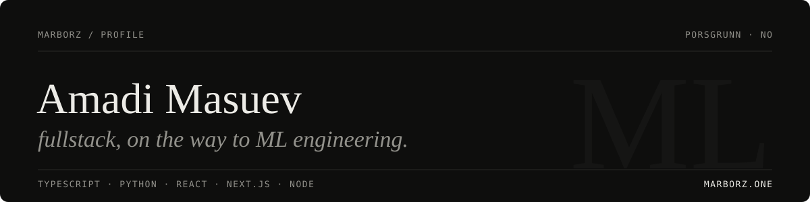
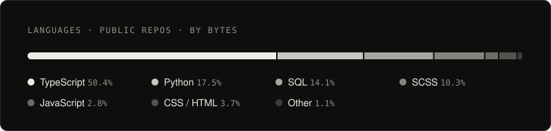

<div align="center">

<sub><code>MARBORZ</code> · <b>English</b> · <a href="README.no.md">Norsk</a></sub>

<picture><source media="(prefers-color-scheme: dark)" srcset="assets/banner-dark.svg"><source media="(prefers-color-scheme: light)" srcset="assets/banner-light.svg"></picture>

Fullstack developer from Porsgrunn, Norway. Writing code since December 2024, now a Vg2 IT student.
Right now I'm sharpening the fundamentals — architecture, Python, C++ — on the way to **ML engineering**.

```text
now        fullstack web · desktop tools
next       machine learning engineering
```

<p align="center"></p>

<picture><source media="(prefers-color-scheme: dark)" srcset="assets/languages-dark.svg"><source media="(prefers-color-scheme: light)" srcset="assets/languages-light.svg"></picture>

**Selected work**

| Project | What | Stack | Live |
|:--|:--|:--|:--|
| [**omioroom**](https://github.com/MARBORZ/omioroom) | Watch parties for 2–32 people, video in sync | <sub><code>React · Supabase Realtime</code></sub> | [omioroom.live](https://www.omioroom.live) |
| [**lecture-studio**](https://github.com/MARBORZ/lecture-studio) | Turns recorded lectures into study material | <sub><code>FastAPI · Faster-Whisper · React</code></sub> | desktop app |
| [**velnote**](https://github.com/MARBORZ/velnote) | Markdown notes with tags and auth | <sub><code>React · Express · PostgreSQL</code></sub> | [velnote](https://velnote-two.vercel.app) |
| [**maskin-anlegg-as**](https://github.com/MARBORZ/maskin-anlegg-as) | Client site, MK Maskin & Anlegg AS | <sub><code>Next.js · Motion · Resend</code></sub> | [mkmaskin.no](https://mkmaskin.no) |
| [**redbeardvfx**](https://github.com/MARBORZ/redbeardvfx) | Client portfolio for a VFX supervisor | <sub><code>React · Vite · FSD</code></sub> | [redbeardvfx.work](https://redbeardvfx.work) |
| [**death-trip-site**](https://github.com/MARBORZ/death-trip-site) | Dark-aesthetic site, built in a team of two | <sub><code>React · Motion · Lenis</code></sub> | [hdufndsk.site](https://hdufndsk.site) |

<sub><code>PORTFOLIO</code> [marborz.one](https://www.marborz.one) · <code>MAIL</code> [masuevamadi@marborz.one](mailto:masuevamadi@marborz.one)</sub>

</div>
