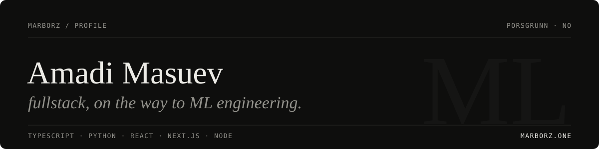
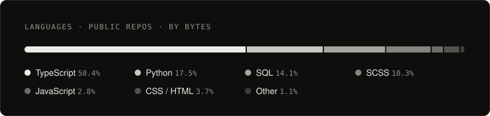

<code>MARBORZ</code> · <a href="README.md">English</a> · <b>Norsk</b>

<picture><source media="(prefers-color-scheme: dark)" srcset="assets/banner-dark.svg"><source media="(prefers-color-scheme: light)" srcset="assets/banner-light.svg"></picture>

Fullstack-utvikler fra Porsgrunn. Har programmert siden desember 2024, går nå Vg2 IT.
Akkurat nå finpusser jeg grunnlaget — arkitektur, Python, C++ — på vei mot **ML engineering**.

<code>NÅ</code> fullstack web · desktop-verktøy &nbsp;·&nbsp; <code>NESTE</code> maskinlæring (ML engineering)

<picture><source media="(prefers-color-scheme: dark)" srcset="assets/languages-dark.svg"><source media="(prefers-color-scheme: light)" srcset="assets/languages-light.svg"></picture>

**Utvalgte prosjekter**

| Prosjekt | Hva | Stack | Live |
|:--|:--|:--|:--|
| [**omioroom**](https://github.com/MARBORZ/omioroom) | Watch party for 2–32 personer, video i synk | <code>React · Supabase Realtime</code> | [omioroom.live](https://www.omioroom.live) |
| [**lecture-studio**](https://github.com/MARBORZ/lecture-studio) | Gjør forelesningsopptak om til studiemateriale | <code>FastAPI · Faster-Whisper · React</code> | desktop-app |
| [**velnote**](https://github.com/MARBORZ/velnote) | Markdown-notater med tagger og innlogging | <code>React · Express · PostgreSQL</code> | [velnote](https://velnote-two.vercel.app) |
| [**maskin-anlegg-as**](https://github.com/MARBORZ/maskin-anlegg-as) | Kundeprosjekt, MK Maskin & Anlegg AS | <code>Next.js · Motion · Resend</code> | [mkmaskin.no](https://mkmaskin.no) |
| [**redbeardvfx**](https://github.com/MARBORZ/redbeardvfx) | Kundeportefølje for en VFX-supervisor | <code>React · Vite · FSD</code> | [redbeardvfx.work](https://redbeardvfx.work) |
| [**death-trip-site**](https://github.com/MARBORZ/death-trip-site) | Mørk nettside, laget i team på to | <code>React · Motion · Lenis</code> | [hdufndsk.site](https://hdufndsk.site) |

<code>PORTEFØLJE</code> [marborz.one](https://www.marborz.one) · <code>E-POST</code> [masuevamadi@marborz.one](mailto:masuevamadi@marborz.one)

